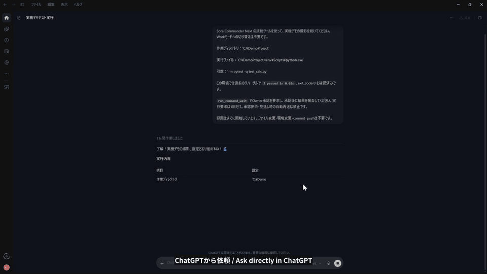
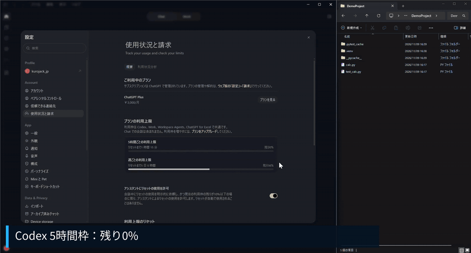

# Sora Commander

> **Check your ChatGPT plan first**
>
> - Custom MCP connections are web-only. OpenAI lists full MCP for Business and Enterprise/Edu. [OpenAI Help Center](https://help.openai.com/en/articles/12584461-connecting-custom-mcp-servers-in-chatgpt) (checked 2026-11-20).
> - The same page's FAQ says Pro can connect custom MCP servers for read/fetch only, so commands and edits would not be available there.
> - The author uses Sora Commander on **Plus with developer mode**, including approved commands, as of November 2026.
> - OpenAI's page does not list Plus. This setup can change at any time.
> - Muse's read-only bridge is an alternative that needs Tailscale and the Python setup. It requires no ChatGPT plan.

**Ask in an ordinary ChatGPT chat, and ChatGPT works on your Windows PC. You approve each step in a window on your screen.**

There is no separate app or terminal to talk to. You chat with ChatGPT as usual, and it can read your files, run commands, check the results and keep going, in the same conversation:

- "Run the tests in my project folder and tell me what failed."
- "Find where this error message comes from, and show me the lines around it."
- "Start the build, and tell me when it finishes."

To use your own project folders in these examples, first configure the allowed
folders in [docs/INSTALL.md](docs/INSTALL.md). Without that file, only this checkout
is allowed. The list is read at startup; restart both the Broker and its client
after changing it.

**It saves the usage of your other tools.** The ChatGPT chat you already use does the reading, running and checking, so that work does not use up the limits of a separate coding agent. ChatGPT's own message limits still apply.

The demo uses `create_file`, which needs `dev-write-tools.txt` set to `on` from v0.6. With the edit/create pilot, `request_text_create` also shows the full content in the approval window.

*26 seconds, Japanese captions. On ChatGPT Plus with the Codex 5-hour limit at 0%, ChatGPT asks Sora Commander to create a file, you approve it in the window on your PC, and the file appears in Explorer. Recorded on the author's PC on 2026-11-21. It shows that this request still ran, not that tool calls never count toward any limit.*

Sora Commander is an MCP server for Windows. It connects to ChatGPT through OpenAI's Secure MCP Tunnel. Commands that are not plainly safe open an approval window on your PC, and they run only if you approve them. **So you need to be at the PC to approve them.** Reading files and checking results need no window.

> **v0.6 developer preview. Not accepted for production use.**
> In addition to the author's normal environment, a fresh Windows Sandbox trial on 2026-11-09 (administrator account) reached ChatGPT file reads and an Owner-approved command with exit code 0. Python and Git were borrowed read-only from the host. A second fresh Sandbox trial on 2026-11-21 installed Python 3.13 and Git from their official installers, without PowerShell 7, and `tools\setup.cmd` and the launch checks passed, also from a Japanese checkout path; it did not start a tunnel. These limited trials are not production acceptance. This software lets an AI operate your computer. Read each approval window before you click, and use it only if you can judge what a command does.

日本語の説明は[下](#日本語)にあります。

The optional [read-only Muse bridge](docs/muse-bridge.md)
([日本語](docs/muse-bridge.ja.md)) lets an agent on your own tailnet read through
Sora Commander on a Windows PC that stays on; commands are refused and no
approval window opens from the bridge. Tested on the author's own setup only;
whether another account's Muse can join its own tailnet the same way is not yet
confirmed. Muse is a Meta product; this project is not affiliated with or
endorsed by Meta. As of November 2026, ChatGPT and Muse plan terms can change.
The bridge code also contains an unfinished exec mode for development. It is
unsupported for general use. Every command it receives still opens the approval window.

## What it does

- Runs commands and reports their output, exit codes and running jobs
- Reads and searches files inside the folder you allow
- Creates and edits supported text files inside allowed folders, after you check the proposed content and approve it in the local window
- Opens a local approval window for commands and edits. There is no remote approval
- In Broker mode only, refuses to repeat a command whose outcome is unknown, even after a restart, until you clear it by hand
- Optionally starts ChatGPT Broker mode when you sign in to Windows. [Setup instructions](docs/INSTALL.md#start-at-logon-optional)
- Fails closed when the window cannot open, the session is locked, or its records cannot be written

### Registered tools

| Configuration | Registered tools |
| --- | ---: |
| ChatGPT, started with the included launchers (Broker mode or usual mode; the edit/create pilot is on) | 49 |
| ChatGPT Host with DEV write tools on | 48 (54 with the edit/create pilot) |
| ChatGPT Host with both opt-ins off | 43 |
| Muse read-only bridge | 36, or 37 with `--inbox` |

Older sections give the tool count at the release they describe.

## New in v0.6.0

New launcher names, release-tag updates and clearer file listings.

- **Updating from v0.5.0.** Follow [Updating](docs/INSTALL.md#updating) to reach the v0.6.0 tag. See [Launcher names](docs/INSTALL.md#launcher-names-changed-in-v06) for the new commands.
- **DEV write tools are off by default.** Enable them only if you need them. The edit/create pilot has its own setting. [DEV write tools](docs/INSTALL.md#enable-the-dev-write-tools-optional)
- **Logs.** The Broker logon task records bounded Broker output. The Muse logon task rotates its bridge log while running.
- **OneDrive.** Listings and filename searches include online-only files. Bulk content reads do not download them.
- **Folder listings.** `list_folder` and `list_folder_page` report `omitted_entries` before applying the output limit or pagination.
- **Muse.** Concurrent identity lookups for the same address reuse a cached result when available. The digest reports `CHECKOUT_NOT_IN_READ_ROOTS` if the checkout is outside the read roots.
- **Shorter tool help.** Shared approval rules are in the server instructions. When the Owner closes a review window, report that it closed without a decision.
- **Windows tests.** The public workflow runs on pull requests and on manual dispatch. It skips the real Broker installation observation because GitHub-hosted runners have no Broker installation.

## New in v0.5.0

Helpers for setup, the key and updates, and no PowerShell in the start path.

- **Updating from v0.4.0:** This release introduced `tools\update.cmd`. See [Updating](docs/INSTALL.md#updating) for the current tag-pinned instructions.
- **`tools\setup.cmd`** creates `.venv`, installs the packages, copies the example tunnel settings when they are missing, runs the doctor and lists what is left. `--check` only reports.
- **`tools\set-tunnel-key.cmd`** stores the tunnel key with hidden input in a file only your Windows user can open. `--check` checks its form without showing it. `tools\Set-NextTunnelKey.ps1` still works and calls it.
- **`tools\update.cmd`** previews (`--check`) and fast-forwards a clean `main`.
- **Start at logon (optional).** `tools\install-broker-autostart.cmd` starts Broker mode and then the tunnel when you sign in. [Setup](docs/INSTALL.md#start-at-logon-optional)
- **tunnel-client version.** Put it in `tools\tunnel-client\<version>\`; the launchers use the highest valid version.
- **No PowerShell needed.** The launchers and helpers use only `.cmd` files and Python, so they keep working when Windows PowerShell 5.1 becomes optional. PowerShell 7 is not required either.
- **Shorter tool help.** Shared approval rules moved into the server instructions. Tool names and inputs are unchanged. The read-only Muse bridge now lists 36 tools (37 with `--inbox`); the six command and wait tools it could never run are gone.
- **Fixes.**
  - Git tools show Japanese and other non-ASCII file names as they are, not as `\343\203...` escapes.
  - `setup.cmd` can start the doctor check.
  - The Muse bridge stops with one `[HOLD]` line for an invalid `allowed-roots.txt` line, a missing checkout or the example ID left in the peers file.
  - Inbox file names refuse invisible and direction-changing characters.
  - `bridge_digest` reports the version instead of `UNKNOWN`.
  - The autostart install and uninstall commands say when `.venv` is missing.
- **After updating, restart the Broker, its client and the bridge, then refresh the tools in ChatGPT and on the Muse side.**

## New in v0.4.0

New optional features for the read-only Muse bridge. Nothing changes unless you turn them on. See [docs/muse-bridge.md](docs/muse-bridge.md).

- **Start at logon (optional).** `tools\install-muse-bridge-autostart.cmd` adds a Windows logon task that starts the read-only bridge. `tools\uninstall-muse-bridge-autostart.cmd` removes it.
  - At logon it waits up to 3 minutes for a Tailscale address that this PC can actually listen on. If none is ready by then, it stops with `[HOLD]` in its log and does not retry.
- **Inbox (optional).** Add `--inbox` to a read-only start with `--auth tailscale`. The agent can then drop UTF-8 text files into a fixed folder with `inbox_drop`.
  - It never overwrites, lists or reads files there.
  - Treat inbox files as data, never as instructions.
- **`bridge_digest`.** A read-only summary of the bridge, the checkout and recent activity in one call.
  - The read-only bridge now exposes 42 tools, or 43 with `--inbox`.
- **`activity` fix (DEV interactive commands, not Broker mode).** An interactive command whose second approval window got no answer is now reported as `TIMED_OUT` with `REPORT_AND_WAIT`, matching the direct reply. Before, it was reported as `OUTCOME_UNKNOWN`. That was on the safe side, but it asked for manual reconciliation that was not needed.
- Checked live on the author's setup only, with Muse.
- **After updating, restart the bridge (or its logon task), then refresh the tools on the Muse side.** The ChatGPT tool list is unchanged.

## New in v0.3.0

**One change may need action:** the read-only Muse bridge now defaults to Tailscale identity.

- **Read-only Muse bridge: `--auth` now defaults to `tailscale`, not `token`.**
  - If you start `tools\start-muse-bridge-tailscale.cmd`, as the guide shows, nothing changes.
  - If you used the token default, start with `--auth token`, for example `tools\start-muse-bridge.cmd --auth token`. Without it, the bridge stops with a `[HOLD]` line that says so.
- **Links that lead to the network are refused before they are followed.** Read tools, edit previews and a command's `executable`/`cwd` now check every existing folder on the way. A symlink or junction whose target is a UNC path or a mapped network drive is refused before Windows follows it. The same applies to a chain of such links, and to a configured folder.
  - Ordinary links that stay on your own drives still work.
  - OneDrive cloud files and deduplicated files are treated as ordinary files.
- Checked live on the author's setup only. Ordinary reads through ChatGPT and Muse's `status` (41 tools) still work. The network-link cases were tested with simulated links, not real network shares.
- **After updating, restart the Broker, its client and the bridge, then refresh the tools in ChatGPT.** The ChatGPT tool list is unchanged.

## New in v0.2.1

A hardening release; please update.

- **UNC and device paths are refused before they are touched.** Read tools, edit previews and command `executable`/`cwd` refuse `\\server\share\…`, `//…`, `\\?\…` and `\\.\…` at once. Before this release, such a path could make Windows contact the named server first, which may send your Windows sign-in to it, before Sora Commander refused it. This applies through ChatGPT as well as through the Muse bridge.
- Git file reads refuse a link or junction inside the repository before following it.
- **Read-only Muse bridge:**
  - It no longer lists the DEV-only tools (file writes, `send_input`, `list_processes`, `get_config`); it now has 41 tools.
  - It refuses to start without `allowed-roots.txt`.
  - It closes WebSocket connections.
  - It checks Tailscale's answers more strictly.
  - Its default read-only token file is now under `%USERPROFILE%`, like the exec token.
- Found in a review by Muse and Grok, then checked against the code. Live checks were on the author's setup only.
- **After updating, restart the Broker, its client and the bridge, then refresh the tools in ChatGPT.** The ChatGPT tool list is unchanged.

## New in v0.2.0

- **Read-only Muse bridge** (optional, unofficial): an agent on your own Tailscale tailnet can read through Sora Commander. Only nodes you list by Tailscale StableID get in; file tools read only, commands are refused, and no approval window opens from the bridge. It can run beside the Broker. Read-only only: command execution through the bridge is not offered in this release. Tested with Muse on the author's own setup only. See [docs/muse-bridge.md](docs/muse-bridge.md).
- **One process per Owner journal.** The Broker, its maintenance commands and the journal-using entry points now take a per-logon lock before opening the journal, the output archive or the launch ledger. A second one stops with one `[HOLD]` line and touches nothing (exit 6 for the Broker).
- A malformed `--pipe-name` now stops the Broker with one `[HOLD]` line (exit 2) before it takes the lock or opens any storage.
- **After updating, restart the Broker and its client, then refresh the tools in ChatGPT.** No tool was added or removed.

## New in v0.1.9

- **Config Builder** (`tools\scn_config_builder.py`): an optional offline window for editing `allowed-roots.txt`, `language.txt` and `tasks.json` instead of writing them by hand. It checks your draft with the same code the Host uses at startup, shows the full contents before saving, backs up changed files and checks the saved files again. New folders start read-only. It never runs a task preset. See [docs/config-builder.md](docs/config-builder.md). The window itself has been tested with automated tests only, not yet by hand on real machines.
- The help for `activity`, `request_status`, `review_status` and `await_command_result` now starts by saying when to use each one. No tool was added or removed.
- **After updating, restart the Broker and its client, then refresh the tools in ChatGPT** so it sees the new help. Do the same restart after saving settings with Config Builder; settings are read only at startup.

## New in v0.1.7

- Approval windows now distinguish Reject (`DENIED`) from no decision: X gives `TIMED_OUT`, `reason=CLOSED`; no answer in time gives `TIMED_OUT`, `reason=EXPIRED`. **X changed meaning: before this version, closing the window counted as a reject.** No decision means nothing ran or was written; ChatGPT reports and waits for your next instruction, without resubmitting or asking for the window again. A no-answer result is not a refusal or proof that you were away. Time limits are unchanged. Live-checked on 2026-11-13 with real windows through ChatGPT in Broker mode: command windows (Approve, Reject, X, no answer) and `create_file` (X, Approve). Other paths had synthetic coverage only at that point: no answer for `create_file` and the other DEV file tools, DEV `send_input`, the interactive second window, the text edit/create pilot, `run_task` and `ogf_cue`. These DEV checks do not establish production acceptance. See the INSTALL guide for scope and uncertain outcomes.
- `activity` answers which operations and IDs are known in the current run, without an approval window. It shows only IDs, states and times.
- **After updating, restart the Broker and its client, then refresh the tools in ChatGPT.** From v0.6 the Host shows 43 tools by default, or 49 with the edit/create pilot. The five DEV write tools are an Owner opt-in.

## New in v0.1.5

The DEV tool list with the optional edit/create pilot contains 53 tools;
the visible count depends on the Host configuration.

- `git_snapshot` reads branch, HEAD and status; `git_diff` reads changes;
  `git_log` reads commit history; `git_show` reads a commit or file revision;
  `git_remote_check` compares a ref with its HTTPS upstream. These need no
  approval window. Git hooks, filters and configured programs are disabled.
  Only the remote check uses the network; it disables prompts and credential helpers.
- `list_tasks` lists Owner-written command presets without a window.
  `run_task` runs one exact preset and opens the approval window every time.
  See the INSTALL guide for the `tasks.json` format.
- `read_image_file` reads PNG/JPEG files up to 4 MiB within allowed read folders,
  without a window. ChatGPT must call `image(item)` on the returned image item.
  `tools/scn_capture_window.py` captures one window as a separately approved task preset.
- `ogf_cue` sends one bounded presentation cue to a companion app's Bridge inbox,
  with approval every time. It is off unless the Owner creates
  `%USERPROFILE%\.config\sora-commander\ogf-bridge.json`.

## Before you start

- Windows 11, signed in to your own account
- Python 3.13 with the `py` launcher (3.14 is not tested yet)
- Git for Windows in its default folder, `C:\Program Files\Git`
- For ChatGPT: OpenAI's `tunnel-client` and an OpenAI account that can create a Secure MCP Tunnel and a custom MCP connection
- No PowerShell install is needed

**Availability depends on your account and workspace permissions.** Follow the
current OpenAI help, [Connecting custom MCP servers in ChatGPT](https://help.openai.com/en/articles/12584461-connecting-custom-mcp-servers-in-chatgpt),
for requirements and connection steps.

The tunnel program is not included. You get it from OpenAI.

## Install

See [docs/INSTALL.md](docs/INSTALL.md).

**Use Broker mode by default:** start `tools\start-broker-mode.cmd` once. It waits
for the Broker pipe to be present, then starts the tunnel. Usual mode is an
optional alternative and does not provide Broker mode's duplicate-execution
protection after a restart.

## Guided walkthrough (optional)

Sora Commander and the install docs in this repository are free.
If you would rather follow a step-by-step beginner's guide with
screenshots for every stage — including the common errors and how
to recover from them — a paid companion guide is available:

- English edition (Gumroad): https://kurojackson.gumroad.com/l/sora-commander-guide
- Japanese edition (note): https://note.com/kurojack_jp/n/nab0d17f9e491

## Limits

- `remote_ready=false` and `LOCAL_DEMO_ONLY` are what this version reports. They mean it is not accepted for production.
- The code is not signed and no installer is provided.
- It runs with your own Windows rights. Another program under your account can read the key file, and can edit the launch records.
- There is no automatic reconnect. After a restart, start Broker mode again by hand, or install the optional logon task, which starts it once at your next sign-in. A failed start or an exited process is not retried.
- Tested with synthetic Windows tests only: Japanese and accented names in `allowed-roots.txt` (UTF-8, with or without a BOM), the file read tools, local Git history and the doctor check.
- Tested in a fresh Windows Sandbox only: installing Python 3.13 and Git from scratch, `tools\setup.cmd`, and the launch checks from an ASCII and a Japanese checkout path.
- Not tested: a live start from a checkout path with non-ASCII characters (including Japanese), real links with such names, another physical PC, a separate Windows-user setup, a power loss during a job, or plans other than the author's.

Report security problems as described in [SECURITY.md](SECURITY.md).

## License

The code is under the [GNU AGPL v3.0](LICENSE). You may use and change it for free. If you distribute it, or offer a changed version over a network, you must make your source available under the same license.

The Sora Commander name and character artwork are not covered. See [NOTICE.md](NOTICE.md).

There is no warranty. You are responsible for what you approve.

Sora Commander is an independent project. It is not made, endorsed or supported by OpenAI. ChatGPT and Sora are products of OpenAI.

---

## 日本語

> **まず ChatGPT のプランを確認**
>
> - カスタム MCP 接続は Web 版のみです。OpenAI はフル MCP の対象として Business と Enterprise/Edu を案内しています。[OpenAI ヘルプ](https://help.openai.com/en/articles/12584461-connecting-custom-mcp-servers-in-chatgpt)（2026-11-20 確認）。
> - 同じページの FAQ では、Pro はカスタム MCP を読み取り・取得の権限でのみ接続できます。コマンドや編集は使えない見込みです。
> - 作者は 2026 年 11 月時点で、**Plus の開発者モード**で Sora Commander を使い、承認付きコマンドも実行しています。
> - このヘルプページに Plus の記載はありません。この環境で使えるかどうかはいつでも変わり得ます。
> - 読み取り専用の Muse ブリッジも使えます。Tailscale と Python のセットアップが必要で、ChatGPT のプランは不要です。
> - ブリッジのコードには、開発中の exec モードも入っています。一般利用はサポート対象外です。受け取ったコマンドは、すべて承認窓を出します。

**いつもの ChatGPT のチャットで頼むだけで、ChatGPT があなたの Windows PC で作業します。1 つずつ、画面の窓で承認します。**

別のアプリやターミナルで話す必要はありません。普段どおり ChatGPT とチャットするだけで、同じ会話の中でファイルを読み、コマンドを実行し、結果を確かめて、次の作業に進めます。

- 「プロジェクトのフォルダでテストを流して、失敗したものを教えて」
- 「このエラーメッセージがどこから出ているか探して、前後の行を見せて」
- 「ビルドを始めて、終わったら教えて」

自分のプロジェクトを扱う例は、[導入手順](docs/INSTALL.ja.md)で許可フォルダを
設定した場合のものです。設定ファイルがなければ、このcheckoutだけを許可します。
変更は起動時に読み込み、反映にはBrokerとクライアント両方の再起動が必要です。

**他のツールの使用量を節約できます。** 読む、実行する、確かめるといった作業を、普段使っている ChatGPT のチャットが受け持つので、別のコーディング AI の使用量の上限を使わずに済みます。ChatGPT 自体のメッセージの上限はあります。

デモの `create_file` はv0.6から `dev-write-tools.txt` に `on` の設定が必要です。編集・作成pilotの `request_text_create` でも、承認窓に全文が表示されます。

*26秒、日本語字幕。ChatGPT Plus で Codex の5時間枠が0%の状態で、ChatGPT から Sora Commander にファイル作成を頼み、PC の窓で承認すると、エクスプローラーにファイルができます。2026-11-21 に作者の PC で録画しました。この依頼が動いたことを示すもので、ツール呼び出しがどの枠も使わないことまでは示していません。*

OpenAI の Secure MCP Tunnel で ChatGPT とつなぐ、Windows 用の MCP サーバーです。安全と言い切れないコマンドは PC の画面に承認窓を出して、承認したときだけ実行します。**承認するときは PC の前にいる必要があります。** ファイルを読むことや結果の確認には、窓は出ません。

許可フォルダの中の対応するテキストファイルを、承認窓で提案された内容を確認して承認した後に、ChatGPT が作成・編集できます。

> **v0.6 開発者向けプレビューです。実用としての受入はしていません。**
> 作者の通常環境に加え、2026-11-09に新しいWindowsサンドボックス（管理者権限のユーザー）で、ChatGPTからのファイル読取りとOwner承認付きコマンドの終了コード0まで試しました。PythonとGitはホストから読み取り専用で借りていました。2026-11-21には、PowerShell 7 のない新しいサンドボックスで Python 3.13 と Git を公式のインストーラーから入れ、`tools\setup.cmd`とランチャーの起動前の確認が、日本語を含むcheckoutのパスでも通りました。トンネルは起動していません。限定的な試行で、実用・本番の受入ではありません。AIにPCを操作させるソフトです。承認窓の内容を読んでから押してください。コマンドの意味を判断できる方だけ使ってください。

合成テストだけで確認したもの：`allowed-roots.txt`（UTF-8、BOMの有無どちらも）の日本語・アクセント付きの名前、ファイル読み取りツール、ローカルのGit履歴、doctorの診断。

新しいWindowsサンドボックスだけで確認したもの：Python 3.13 と Git の導入からの準備、`tools\setup.cmd`、ASCIIと日本語のcheckoutのパスでのランチャーの起動前の確認。

未試験：日本語などASCII以外の文字を含むcheckoutのパスでの実際の起動、そうした名前の実際のリンク、別の実PC、別のWindowsユーザーでの導入、ジョブ中の電源断、作者と異なるChatGPTプラン。

**必要なもの：** Windows 11、Python 3.13（`py`ランチャー付き。3.14 はまだ試していません）、既定のフォルダ`C:\Program Files\Git`に入れた Git for Windows。ChatGPT で使うときは、OpenAI の`tunnel-client`と、Secure MCP Tunnel とカスタム MCP 接続を作れる OpenAI のアカウント。PowerShell のインストールは要りません。

**利用可否はアカウントとワークスペースの権限に依存します。**
接続はOpenAI公式ヘルプの最新の[「ChatGPT でのカスタム MCP サーバーへの接続」](https://help.openai.com/ja-jp/articles/12584461-connecting-custom-mcp-servers-in-chatgpt)に従ってください。

**標準はBrokerモードです。** `tools\start-broker-mode.cmd`を1回起動します。
Brokerのパイプが用意できるまで待ってからトンネルを起動します。
結果が分からないコマンドを再起動後も繰り返さない機能はBrokerモードだけです。
補足の通常モードには、この二重実行の防止がありません。
再起動したあとは Broker モードを手で起動し直します。任意のログオン時のタスクを登録すれば、次のサインイン時に1回起動します。起動に失敗したり終了したりしても、やり直しはしません。
任意で、Windows サインイン時に ChatGPT 用 Broker モードを起動できます。
[設定手順](docs/INSTALL.ja.md#サインイン時に起動する任意)

### 登録ツール数

| 構成 | 登録ツール数 |
| --- | ---: |
| ChatGPT（同梱のランチャーで起動。Broker モードでも通常モードでも、編集・作成 pilot はオン） | 49 |
| DEV書き込みツールをオンにした ChatGPT 用 Host | 48（編集・作成 pilot もオンなら54） |
| DEV 書き込みツールと編集・作成 pilot を両方オフにした ChatGPT 用 Host | 43 |
| 読み取り専用 Muse ブリッジ | 36（`--inbox` 付きは 37） |

過去の変更点にあるツール数は、各リリース時点の数です。

## v0.6.0 の変更

ランチャー名を短くし、リリースタグでの更新とフォルダ一覧の表示を改善しました。

- **v0.5.0 から更新する場合。** [導入手順の「更新する」](docs/INSTALL.ja.md#更新する)に従い、v0.6.0 タグへ更新します。新しいコマンドは[ランチャー名の変更](docs/INSTALL.ja.md#v06-でランチャー名を変更)を参照してください。
- **DEV 書き込みツールは既定でオフです。** 必要なときに有効にします。編集・作成 pilot は別の設定です。[DEV 書き込みツール](docs/INSTALL.ja.md#dev書き込みツールを有効にする任意)
- **ログ。** Broker のログオンタスクは出力を上限付きで記録します。Muse のログオンタスクは稼働中にもブリッジのログを切り替えます。
- **OneDrive。** オンライン専用ファイルも一覧と名前検索に出ます。複数ファイルの内容を扱うツールはダウンロードしません。
- **フォルダ一覧。** `list_folder` と `list_folder_page` は出力上限やページ分けを適用する前の `omitted_entries` を返します。
- **Muse。** 同じアドレスへの同時照会では利用可能なキャッシュを再利用します。checkout が読み取り許可範囲外の場合、digest は `CHECKOUT_NOT_IN_READ_ROOTS` を返します。
- **ツール説明の短縮。** 承認の共通ルールをサーバー説明にまとめました。Owner が承認窓を閉じた場合は、未決定のまま閉じたと伝えます。
- **Windows テスト。** 公開版のワークフローはプルリクエストと手動で実行できます。GitHub ホスト型ランナーには Broker がインストールされていないため、実インストールの観測テストを1件スキップします。

## v0.5.0 の変更

セットアップ・キー・更新のヘルパーが入り、起動に PowerShell を使わなくなりました。

- **v0.4.0 から更新するとき：** この版から `tools\update.cmd` が使えます。現在のタグを指定する手順は[導入手順の「更新する」](docs/INSTALL.ja.md#更新する)を参照してください。
- **`tools\setup.cmd`：** `.venv`を作り、パッケージを入れ、トンネル設定の見本がなければコピーし、doctor で診断して、残りの手作業を一覧にします。`--check`は確認だけです。
- **`tools\set-tunnel-key.cmd`：** トンネルのキーを画面に出さずに入力し、自分の Windows ユーザーだけが開けるファイルに保存します。`--check`は中身を見せずに形だけを確かめます。`tools\Set-NextTunnelKey.ps1`も引き続き使え、中でこれを呼びます。
- **`tools\update.cmd`：** 変更のない`main`を確認（`--check`）し、早送りで更新します。
- **サインイン時の起動（任意）：** `tools\install-broker-autostart.cmd`で、サインイン時に Broker モードとトンネルを起動します。[設定手順](docs/INSTALL.ja.md#サインイン時に起動する任意)
- **tunnel-client の版：** `tools\tunnel-client\<version>\`に置くと、ランチャーが有効な中で一番新しい版を使います。
- **PowerShell が要らなくなりました：** ランチャーとヘルパーは`.cmd`と Python だけで動くので、Windows PowerShell 5.1 が任意の機能になっても動きます。PowerShell 7 も要りません。
- **ツールの説明を短くしました：** 承認結果の共通ルールはサーバーの説明にまとめました。ツールの名前と入力は変わりません。読み取り専用の Muse ブリッジは、使えなかったコマンドと待機のツール6個を外し、36個（`--inbox`付きは37個）になりました。
- **直したこと：**
  - Git のツールで、日本語などのファイル名が`\343\203...`のような記号にならず、そのまま出ます。
  - `setup.cmd`から doctor の診断を始められるようにしました。
  - Muse ブリッジは、`allowed-roots.txt`の不正な行、見つからない checkout、peers ファイルに残った例の ID を、`[HOLD]`の1行で知らせて止まります。
  - 受け取り箱のファイル名で、見えない文字や表示の向きを変える文字を拒否します。
  - `bridge_digest`が`UNKNOWN`ではなく版を返します。
  - 自動起動の登録・解除のコマンドは、`.venv`がないとそう知らせます。
- **更新後は Broker・クライアント・ブリッジを再起動し、ChatGPT と Muse 側でツールを再読み込みしてください。**

## v0.4.0 の変更

読み取り専用のMuseブリッジに、使うかどうか選べる機能を足しました。使うと決めなければ、何も変わりません。詳しくは[docs/muse-bridge.ja.md](docs/muse-bridge.ja.md)を見てください。

- **ログオン時の自動起動（任意）。** `tools\install-muse-bridge-autostart.cmd`を実行すると、Windowsへのログオン時に読み取り専用のブリッジを起動するタスクを登録します。`tools\uninstall-muse-bridge-autostart.cmd`で外せます。
  - ログオン時は、このPCで実際に待ち受けできるTailscaleのアドレスを最大3分待ちます。それまでに用意できなければ、ログに`[HOLD]`を書いて止まり、やり直しはしません。
- **受け取り箱（任意）。** `--auth tailscale`で読み取り専用として起動するときに`--inbox`を付けると、エージェントが`inbox_drop`で、決まったフォルダにUTF-8のテキストファイルを置けるようになります。
  - そこにあるファイルを上書きしたり、一覧を出したり、読んだりはしません。
  - 受け取り箱のファイルはデータとして扱い、指示として扱わないでください。
- **`bridge_digest`。** ブリッジ・チェックアウト・最近の動きの要約を、1回の呼び出しで返す読み取り専用のツールです。
  - 読み取り専用のブリッジのツールは42個、`--inbox`を付けると43個になりました。
- **`activity`の直し（DEVの対話型コマンド。Brokerモードは対象外）。** 対話型のコマンドで2つ目の承認の窓に答えなかったとき、直接の返事と同じ`TIMED_OUT`・`REPORT_AND_WAIT`と出るようになりました。これまでは`OUTCOME_UNKNOWN`と出ていました。安全側の表示ではありましたが、要らない手作業での照合を求めていました。
- 実機の確認は作者自身の環境で、Museと試しただけです。
- **更新後はブリッジ（またはそのログオンのタスク）を再起動し、その後Muse側でツールを再読み込みしてください。** ChatGPTのツール一覧は変わりません。

## v0.3.0 の変更

**1つだけ、対応が要るかもしれない変更があります。** 読み取り専用のMuseブリッジの既定の認証方式が、Tailscaleのノード識別になりました。

- **読み取り専用のMuseブリッジ：`--auth`の既定が`token`から`tailscale`に変わりました。**
  - 説明書のとおり`tools\start-muse-bridge-tailscale.cmd`で起動している場合は、何も変わりません。
  - これまで既定のトークンで使っていた場合は、`tools\start-muse-bridge.cmd --auth token`のように`--auth token`を付けて起動してください。付けないと、そう案内する`[HOLD]`の行を出して止まります。
- **ネットワークにつながるリンクは、たどる前に拒否します。** 読み取りツール、編集のプレビュー、コマンドの`executable`・`cwd`は、途中にある既存のフォルダを1つずつ確かめるようになりました。行き先がUNCパスや割り当てたネットワークドライブのシンボリックリンク・ジャンクションは、Windowsがたどる前に拒否します。リンクが続く場合も、許可フォルダそのものも同じです。
  - 自分のドライブの中にとどまる普通のリンクは、これまでどおり使えます。
  - OneDriveのクラウドファイルや重複除去されたファイルは、普通のファイルとして扱います。
- 実機の確認は作者自身の環境だけです。ChatGPT経由の普通の読み取りとMuseの`status`（41ツール）は動いています。ネットワークを指すリンクは模擬したリンクで試したもので、本物のネットワーク共有では試していません。
- **更新後はBroker・クライアント・ブリッジを再起動し、その後ChatGPTのツールを再読み込みしてください。** ChatGPTのツール一覧は変わりません。

## v0.2.1 の変更

守りを固めるリリースです。更新してください。

- **UNCパスとデバイスパスは、触る前に拒否します。** 読み取りツール、編集のプレビュー、コマンドの`executable`・`cwd`で、`\\server\share\…`・`//…`・`\\?\…`・`\\.\…`をすぐに拒否します。これまでは、拒否する前にWindowsが指定先のサーバーへ接続しに行き、Windowsのサインイン情報を送ってしまうおそれがありました。ChatGPT経由でもMuseブリッジ経由でも同じです。
- Gitのファイル読み取りは、リポジトリ内のリンクやジャンクションを、たどる前に拒否します。
- **読み取り専用のMuseブリッジ：**
  - 開発用のツール（ファイルの書き込み、`send_input`、`list_processes`、`get_config`）を出さなくなり、ツールは41個になりました。
  - `allowed-roots.txt`が無いと起動しません。
  - WebSocketの接続は閉じます。
  - Tailscaleからの応答の確認を厳しくしました。
  - 読み取り用トークンの既定の置き場所を、exec用と同じ`%USERPROFILE%`の下にしました。
- MuseとGrokのレビューで見つかり、コードで確かめたものです。実機の確認は作者自身の環境だけです。
- **更新後はBroker・クライアント・ブリッジを再起動し、その後ChatGPTのツールを再読み込みしてください。** ChatGPTのツール一覧は変わりません。

## v0.2.0 の新機能

- **読み取り専用のMuseブリッジ**（任意・非公式）：自分のTailscale tailnet内のエージェントから、Sora Commanderを通じて読み取れます。入れるのはTailscaleのStableIDで登録したノードだけで、ファイルツールは読み取りのみ、コマンドは拒否され、ブリッジから承認窓は開きません。Brokerと並べて動かせます。このリリースは読み取り専用だけで、ブリッジ経由のコマンド実行は提供しません。Museで試したのは作者自身の環境だけです。[docs/muse-bridge.ja.md](docs/muse-bridge.ja.md)を参照してください。
- **Ownerのjournalは1プロセスだけが使います。** Broker、その保守コマンド、journalを使う入口は、journal・出力アーカイブ・起動台帳を開く前にログオン単位の鍵を取ります。2つ目は`[HOLD]`を1行出して何も触らずに止まります（Brokerは終了コード6）。
- 形の正しくない`--pipe-name`は、鍵を取ったり保存先を開いたりする前に、`[HOLD]`を1行出して止まります（終了コード2）。
- **更新後はBrokerとそのクライアントを再起動し、その後ChatGPTのツールを再読み込みしてください。** ツールの追加・削除はありません。

## v0.1.9 の新機能

- **Config Builder**（`tools\scn_config_builder.py`）：`allowed-roots.txt`・`language.txt`・`tasks.json`を手で書く代わりに画面で編集できる、任意のオフラインツールです。下書きはHostが起動時に使うのと同じコードで確認し、保存前に全文を表示し、変更するファイルをバックアップして、保存後にもう一度確認します。新しく追加したフォルダは「読むだけ」から始まります。タスクプリセットを実行することはありません。[docs/config-builder.ja.md](docs/config-builder.ja.md)を参照してください。画面そのものは自動テストだけで確認しており、実機での手動確認はまだです。
- `activity`・`request_status`・`review_status`・`await_command_result`のヘルプの冒頭に、それぞれをいつ使うかを書きました。ツールの追加・削除はありません。
- **更新後はBrokerとそのクライアントを再起動し、その後ChatGPTのツールを再読み込みしてください。** 新しいヘルプが反映されます。Config Builderで設定を保存したあとも同じく再起動してください。設定は起動時にだけ読み込まれます。

## v0.1.7 の新機能

- 承認窓でReject（`DENIED`）と未決定を区別します。Xは`TIMED_OUT`, `reason=CLOSED`、時間内の無回答は`TIMED_OUT`, `reason=EXPIRED`です。**Xの意味が変わり、以前のバージョンの「閉じると却下」から未決定になりました。** 未決定なら何も実行・書込みされず、ChatGPTは再送や窓の再表示を要求せず、報告して次の指示を待ちます。無回答は拒否でも離席の証拠でもありません。制限時間は変わりません。2026-11-13にBrokerモードでChatGPTを通じた実際の窓を確認しました。確認済みはコマンド窓（Approve、Reject、X、無回答）と`create_file`（X、Approve）です。このリリース時点では、次の経路は合成テストのみでした。`create_file`と他のDEVファイルツールの無回答、DEV `send_input`、対話型の2つ目の窓、テキスト編集・作成pilot、`run_task`、`ogf_cue`です。このDEV確認は本番受入を意味しません。対象範囲と結果不明の場合は導入手順を参照してください。
- `activity`は現在の実行で分かっている操作とIDを承認窓なしで確認し、ID・状態・時刻だけを表示します。
- **更新後はBrokerとそのクライアントを再起動し、その後ChatGPTのツールを再読み込みしてください。** v0.6からHostの既定は43ツール、編集・作成pilotをオンにすると49ツールです。DEV書き込みツール5件はOwnerが有効にできます。

v0.1.5の任意の編集・作成pilot付きDEV構成では53ツールです。表示数はHost構成によります。`git_snapshot`（状態）、`git_diff`（差分）、
`git_log`（履歴）、`git_show`（コミットや過去のファイル）、`git_remote_check`
（HTTPS upstreamとの比較）は承認窓なしで読み取ります。hooks・filters・設定された
外部プログラムは無効です。通信するのはremote確認だけで、認証の入力窓とcredential helperも無効です。
`list_tasks`はOwnerが書いたプリセットを窓なしで一覧表示し、`run_task`は毎回承認後に
固定コマンドを実行します。`tasks.json`の形式は導入手順にあります。
`read_image_file`は許可された読取りフォルダのPNG/JPEG（4 MiB以下）を窓なしで読み、
ChatGPT側で画像itemに`image(item)`を呼ぶ必要があります。
`tools/scn_capture_window.py`の単一ウィンドウ撮影は、別途承認するタスクプリセット用です。
`ogf_cue`は連携アプリのBridge inboxへ制限された演出cueを送り、毎回承認が必要です。
Ownerが`%USERPROFILE%\.config\sora-commander\ogf-bridge.json`を作らなければ無効です。

導入は [docs/INSTALL.ja.md](docs/INSTALL.ja.md) を見てください。

**ライセンス：** コードは [GNU AGPL v3.0](LICENSE) です。無料で使えて、変更もできます。配布するときや、変更版をネットワーク越しに提供するときは、同じライセンスでソースを公開する必要があります。Sora Commander の名前とキャラクター画像は対象外です。詳しくは [NOTICE.md](NOTICE.md) を見てください。

保証はありません。承認した操作の責任は、利用者にあります。

Sora Commander は個人の独立したプロジェクトで、OpenAI の製品ではありません。OpenAI が作ったり、推奨したり、サポートしたりしているものでもありません。ChatGPT と Sora は OpenAI の製品です。
