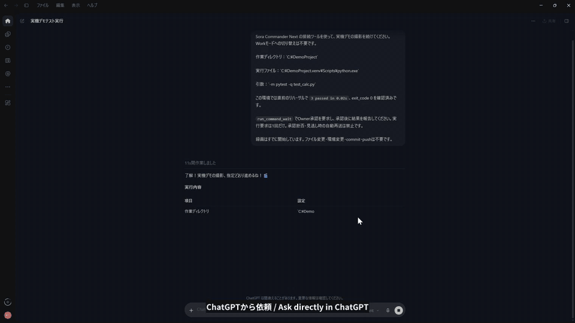

# Sora Commander

**Ask in an ordinary ChatGPT chat, and ChatGPT works on your Windows PC. You approve each step in a window on your screen.**

There is no separate app or terminal to talk to. You chat with ChatGPT as usual, and it can read your files, run commands, check the results and keep going, in the same conversation:

- "Run the tests in my project folder and tell me what failed."
- "Find where this error message comes from, and show me the lines around it."
- "Start the build, and tell me when it finishes."

To use your own project folders in these examples, first configure the allowed
folders in [docs/INSTALL.md](docs/INSTALL.md). Without that file, only this checkout
is allowed. The list is read at startup; restart both the Broker and its client
after changing it.

**It saves the usage of your other tools.** The ChatGPT chat you already use does the reading, running and checking, so that work does not use up the limits of a separate coding agent. ChatGPT's own message limits still apply.

Sora Commander is an MCP server for Windows. It connects to ChatGPT through OpenAI's Secure MCP Tunnel. Commands that are not plainly safe open an approval window on your PC, and they run only if you approve them. **So you need to be at the PC to approve them.** Reading files and checking results need no window.

> **v0.1 developer preview. Not accepted for production use.**
> In addition to the author's normal environment, a fresh Windows Sandbox trial on 2026-11-09 (administrator account) reached ChatGPT file reads and an Owner-approved command with exit code 0. Python and Git were borrowed read-only from the host; installing Python was not tested. This limited trial is not production acceptance. This software lets an AI operate your computer. Read each approval window before you click, and use it only if you can judge what a command does.

日本語の説明は[下](#日本語)にあります。

## What it does

- Runs commands and reports their output, exit codes and running jobs
- Reads and searches files inside the folder you allow
- Creates and edits supported text files inside allowed folders, after you check the proposed content and approve it in the local window
- Opens a local approval window for commands and edits. There is no remote approval
- In Broker mode only, refuses to repeat a command whose outcome is unknown, even after a restart, until you clear it by hand
- Fails closed when the window cannot open, the session is locked, or its records cannot be written

## Before you start

- Windows 11, signed in to your own account
- Python 3.13
- An OpenAI account that can create a Secure MCP Tunnel and a custom MCP connection

**Availability depends on your account and workspace permissions.** Follow the
current OpenAI help, [Connecting custom MCP servers in ChatGPT](https://help.openai.com/en/articles/12584461-connecting-custom-mcp-servers-in-chatgpt),
for requirements and connection steps.

The tunnel program is not included. You get it from OpenAI.

## Install

See [docs/INSTALL.md](docs/INSTALL.md).

**Use Broker mode by default:** start `tools\start-broker-mode.cmd` once. It waits
for the Broker pipe to be present, then starts the tunnel. Usual mode is an
optional alternative and does not provide Broker mode's duplicate-execution
protection after a restart.

## Limits

- `remote_ready=false` and `LOCAL_DEMO_ONLY` are what this version reports. They mean it is not accepted for production.
- The code is not signed and no installer is provided.
- It runs with your own Windows rights. Another program under your account can read the key file, and can edit the launch records.
- There is no automatic reconnect. If the PC restarts, you start it again by hand.
- Not tested: another physical PC, a separate Windows-user setup, installing Python from scratch, paths with non-ASCII characters (including Japanese), a power loss during a job, or plans other than the author's.

Report security problems as described in [SECURITY.md](SECURITY.md).

## License

The code is under the [GNU AGPL v3.0](LICENSE). You may use and change it for free. If you distribute it, or offer a changed version over a network, you must make your source available under the same license.

The Sora Commander name and character artwork are not covered. See [NOTICE.md](NOTICE.md).

There is no warranty. You are responsible for what you approve.

Sora Commander is an independent project. It is not made, endorsed or supported by OpenAI. ChatGPT and Sora are products of OpenAI.

---

## 日本語

**いつもの ChatGPT のチャットで頼むだけで、ChatGPT があなたの Windows PC で作業します。1 つずつ、画面の窓で承認します。**

別のアプリやターミナルで話す必要はありません。普段どおり ChatGPT とチャットするだけで、同じ会話の中でファイルを読み、コマンドを実行し、結果を確かめて、次の作業に進めます。

- 「プロジェクトのフォルダでテストを流して、失敗したものを教えて」
- 「このエラーメッセージがどこから出ているか探して、前後の行を見せて」
- 「ビルドを始めて、終わったら教えて」

自分のプロジェクトを扱う例は、[導入手順](docs/INSTALL.ja.md)で許可フォルダを
設定した場合のものです。設定ファイルがなければ、このcheckoutだけを許可します。
変更は起動時に読み込み、反映にはBrokerとクライアント両方の再起動が必要です。

**他のツールの使用量を節約できます。** 読む、実行する、確かめるといった作業を、普段使っている ChatGPT のチャットが受け持つので、別のコーディング AI の使用量の上限を使わずに済みます。ChatGPT 自体のメッセージの上限はあります。

OpenAI の Secure MCP Tunnel で ChatGPT とつなぐ、Windows 用の MCP サーバーです。安全と言い切れないコマンドは PC の画面に承認窓を出して、承認したときだけ実行します。**承認するときは PC の前にいる必要があります。** ファイルを読むことや結果の確認には、窓は出ません。

許可フォルダの中の対応するテキストファイルを、承認窓で提案された内容を確認して承認した後に、ChatGPT が作成・編集できます。

> **v0.1 開発者向けプレビューです。実用としての受入はしていません。**
> 作者の通常環境に加え、2026-11-09に新しいWindowsサンドボックス（管理者権限のユーザー）で、ChatGPTからのファイル読取りとOwner承認付きコマンドの終了コード0まで試しました。PythonとGitはホストから読み取り専用で借りており、Pythonの導入は試していません。限定的な試行で、実用・本番の受入ではありません。AIにPCを操作させるソフトです。承認窓の内容を読んでから押してください。コマンドの意味を判断できる方だけ使ってください。

未試験：別の実PC、別のWindowsユーザーでの導入、Pythonの導入からの準備、日本語などASCII以外の文字を含むパス、ジョブ中の電源断、作者と異なるChatGPTプラン。

**必要なもの：** Windows 11、Python 3.13、Secure MCP Tunnel とカスタム MCP 接続を作れる OpenAI のアカウント。

**利用可否はアカウントとワークスペースの権限に依存します。**
接続はOpenAI公式ヘルプの最新の[「ChatGPT でのカスタム MCP サーバーへの接続」](https://help.openai.com/ja-jp/articles/12584461-connecting-custom-mcp-servers-in-chatgpt)に従ってください。

**標準はBrokerモードです。** `tools\start-broker-mode.cmd`を1回起動します。
Brokerのパイプが用意できるまで待ってからトンネルを起動します。
結果が分からないコマンドを再起動後も繰り返さない機能はBrokerモードだけです。
補足の通常モードには、この二重実行の防止がありません。

導入は [docs/INSTALL.ja.md](docs/INSTALL.ja.md) を見てください。

**ライセンス：** コードは [GNU AGPL v3.0](LICENSE) です。無料で使えて、変更もできます。配布するときや、変更版をネットワーク越しに提供するときは、同じライセンスでソースを公開する必要があります。Sora Commander の名前とキャラクター画像は対象外です。詳しくは [NOTICE.md](NOTICE.md) を見てください。

保証はありません。承認した操作の責任は、利用者にあります。

Sora Commander は個人の独立したプロジェクトで、OpenAI の製品ではありません。OpenAI が作ったり、推奨したり、サポートしたりしているものでもありません。ChatGPT と Sora は OpenAI の製品です。
